# [Radar Jamming]Noise modulation type jamming under LFM signal echo simulation MATLAB code

MATLAB simulation results  
MATLAB code
if nargin==0\n    T=10e-6;                           %Pulse length 10us\n    B=30e6;                            % Linear Frequency Modulation Bandwidth 30MHz\n    Rmin=10000;Rmax=15000;            % Distance range\n    %R=[10500,11000,12000,12008,13000,13002]; % Ideal point target position\n    R=[12008];\n    %RCS=[1 1 1 1 1 1];                   %RCS\n    RCS=[1];\nend\n%==================================================================\n%%Parameter\nC=3e8;                                 %Light Speed\nK=B/T;                                 % Frequency modulation slope\nRwid=Rmax-Rmin;                        % Receiver window (m)\nTwid=2*Rwid/C;                          % Receiver window (s)\nFs=10*B;Ts=1/Fs;                         %Sampling frequency, sampling period\nNwid=ceil(Twid/Ts);                       % Received window points\n%==================================================================\n%% Noise interference signal\nf1=B/4;% Modulation signal center frequency\nm=0.5;% Adjustment rate\nkfm=5e6;% Frequency modulation slope\nkpm=5;% Phase Shift Slope\nM=1000;\n​\nt=linspace(2*Rmin/C,2*Rmax/C,Nwid);\np=fft(fir1(Nwid-1,0.1));% Filter Spectrum\n%1````````````````````````````````````````````````````````\nxn=ifft(fft(random('Normal',0,1,1,Nwid)).*p);% Limited Gaussian white noise\nphi=2*pi*rand(1,1);%phi follows a uniform distribution from 0 to 2pi\nzn=(2+xn).*cos(2*pi*f1*t+phi);%Noise modulation interference expression\n  

## Images


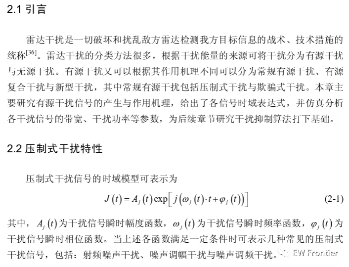
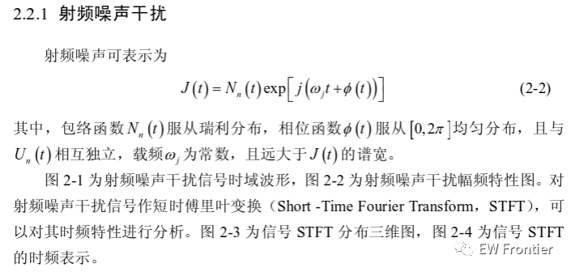
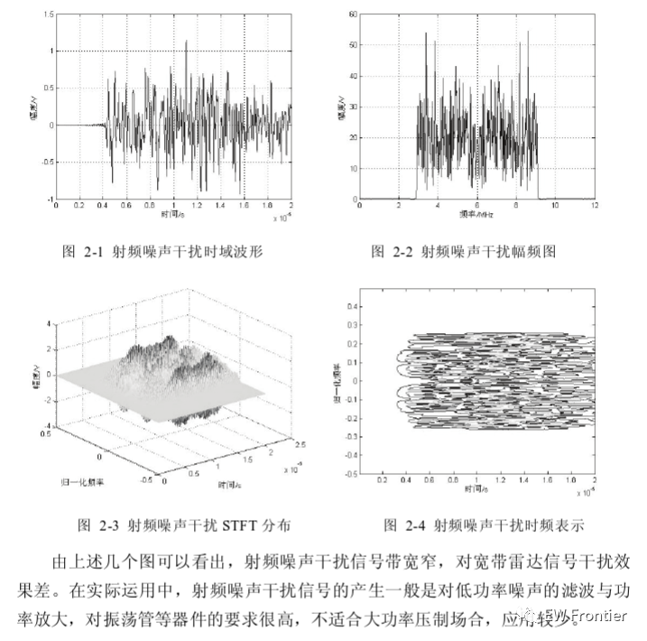
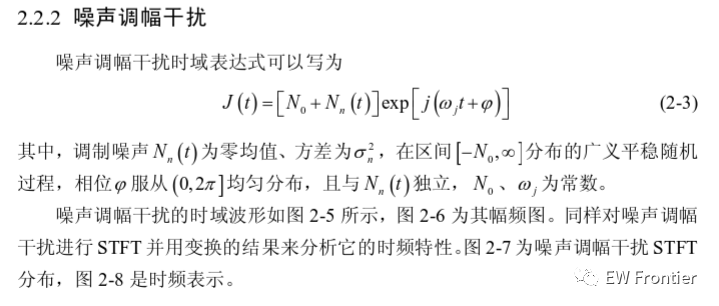
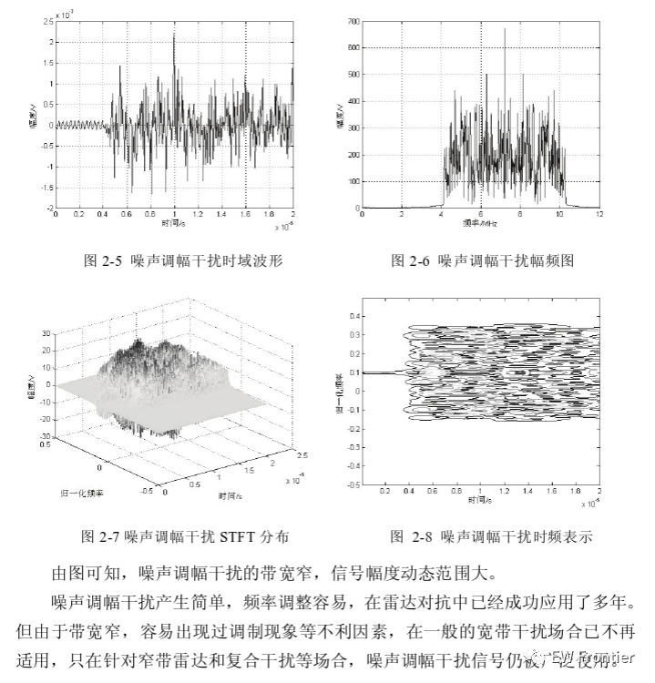
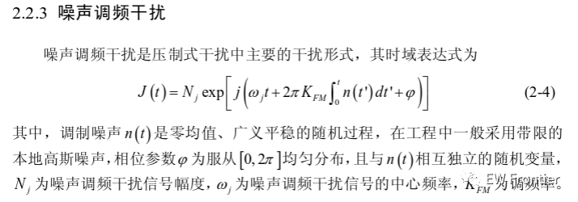
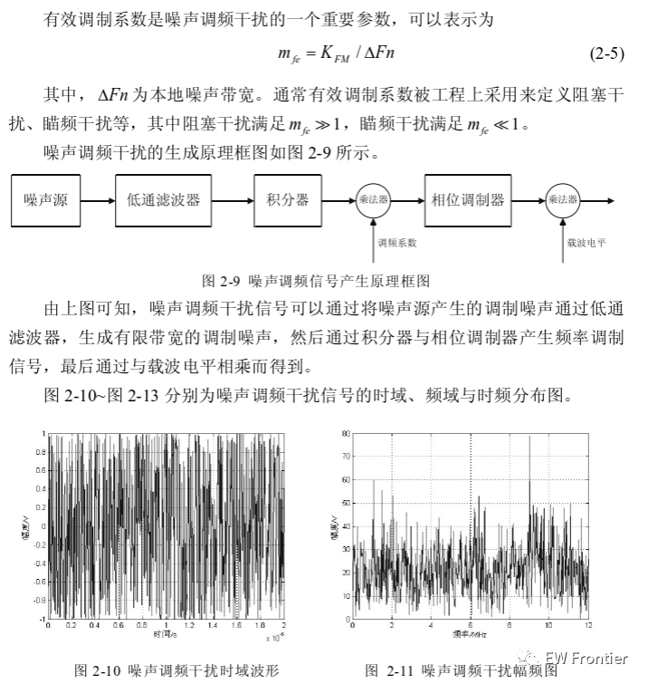
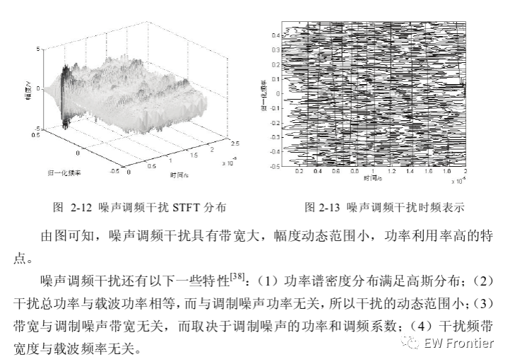
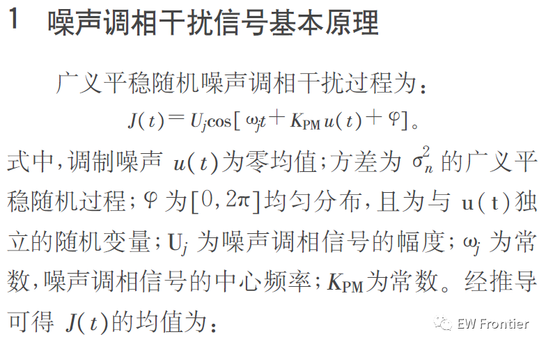
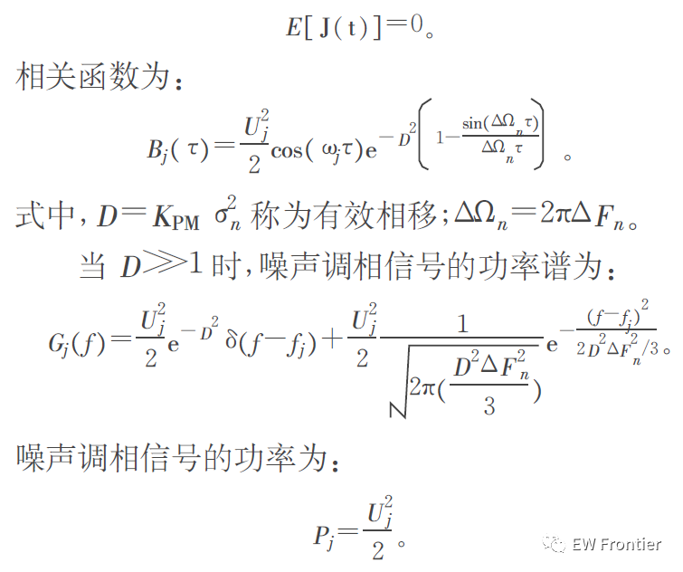
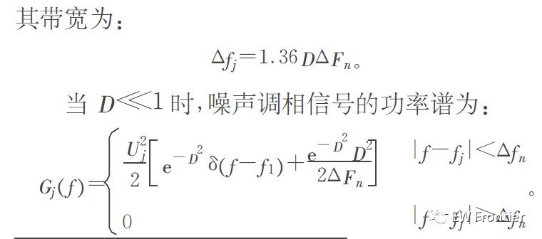
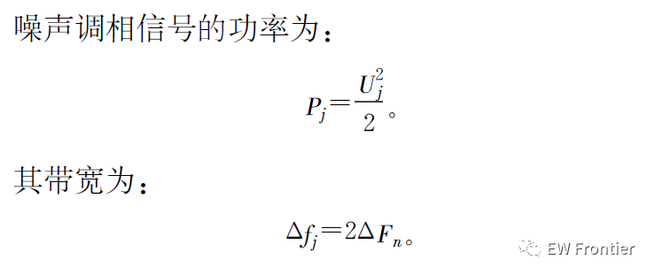
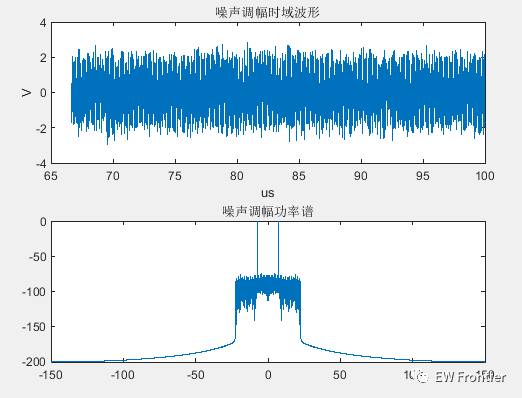
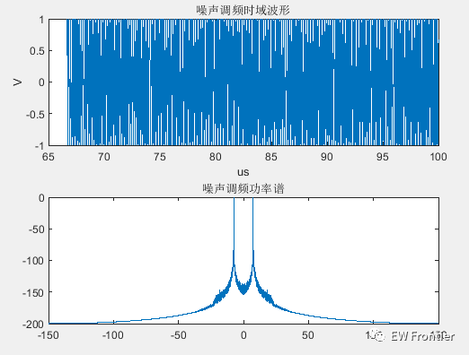
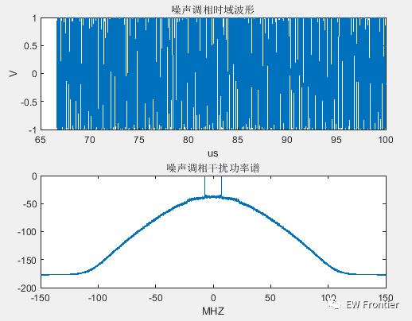
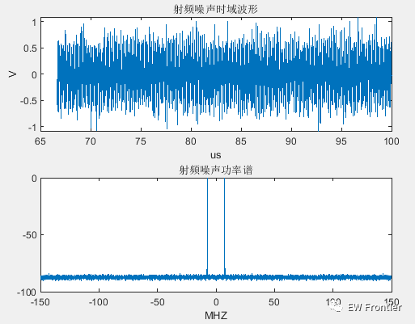
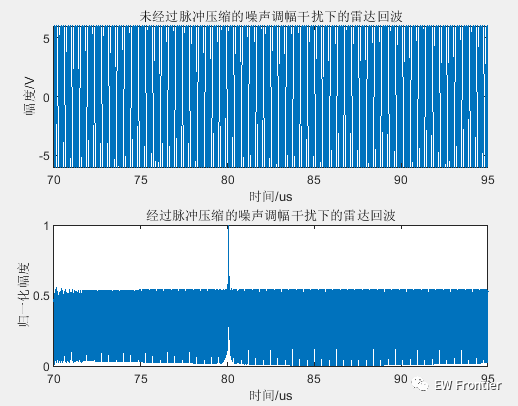

<!-- PAYMENT_BLOCK -->

## Get this dataset

- Payment link (Stripe): [Buy now](https://buy.stripe.com/3cs8yP7sY87d0vu9AB)
- Payment QR code: 

<!-- /PAYMENT_BLOCK -->
